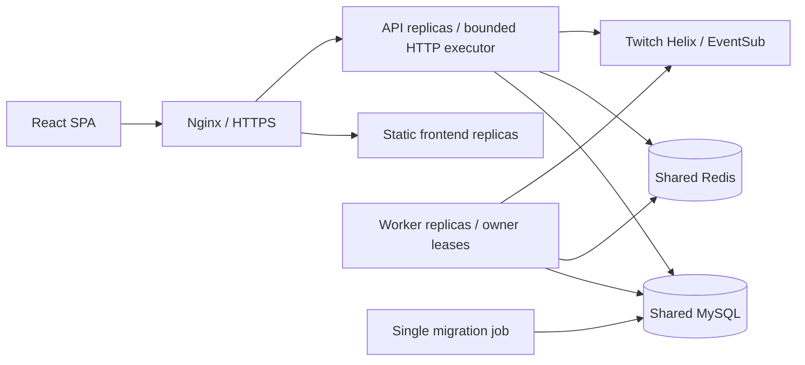

# Архитектура и поведение

## Границы приложения

Один backend image запускается с `CLIPSTREAM_ROLE=api|worker|migrate`. API не выполняет миграции, seed и polling на пути старта HTTP. Blocking SQL и HTTPS отделены от Asio socket loop ограниченным executor. Переполнение очереди возвращает 503 с `Retry-After`; пул БД имеет конечное время ожидания и сетевые timeout.

Controllers отвечают за HTTP/права; services — за рекомендации и внешние интеграции; repositories — за SQL и транзакционные инварианты. Новые области отделены в `AccountSecurityRepository`, `ProfileRepository`, `AdsRepository`. Общий runtime config формируется сервером. Frontend разделён на `app`, `features`, `shared`; сетевой state и отмена запросов принадлежат TanStack Query, формы и временный UI state — компонентам.

Состояние, необходимое нескольким машинам, хранится в MySQL/Redis: сессии и версии отзыва, OAuth state/refresh lease, импортированные клипы, social graph, реклама, квоты и worker leases. Локальные mutex/cache служат оптимизации внутри процесса. Worker lease обновляется владельцем; продление и удаление проверяют owner token. Добавление API replicas само по себе не увеличивает лимиты Twitch.

## Авторизация и права

Вход только через Twitch OAuth Authorization Code. Браузер генерирует verifier, передаёт SHA-256 challenge и хранит verifier в sessionStorage. Сервер связывает одноразовый OAuth state с challenge; callback обязан предъявить verifier. Это защита callback приложения, а не заявление о поддержке Twitch PKCE.

Сервер сверяет пользователя с Twitch, валидирует token на старте работы с ним и не реже часа. Refresh сериализован общим lease и сохраняется в БД. Инфраструктурная ошибка возвращается как временная ошибка, а не как ложный logout. Каждый JWT проверяется по текущему аккаунту и `auth_version`. Выход отзывает сессии пользователя на всех API replicas. Парольные endpoints возвращают 410; старые локальные аккаунты и их данные сохраняются, но парольный вход и их JWT закрыты. Автоматического объединения по email нет.

Первоначальный admin закрепляется singleton-записью при миграции пустой базы. Twitch ID владельца `deexsd` сохраняется после серверного разрешения login; выдача роли транзакционная. Удаление/понижение последнего активного администратора и собственная блокировка защищены сервером. Временное отстранение, постоянный бан и ограничения обсуждений — разные действия. IP ban работает с точным нормализованным IPv4/IPv6; CIDR не поддерживается. Клиентский IP принимается из gateway header только при корректном секретном proof; edge перезаписывает входные заголовки.

## Единые профили и социальные отношения

Канонический адрес Twitch-профиля — `/p/twitch/<immutable Twitch ID>`. Исторические `/channel/<login>` и `/u/<username>` разрешаются в тот же профиль. Для сохранённых локальных аккаунтов без Twitch используется `/p/user/<username>`. Канал, владелец которого ещё не заходил в ClipStream, получает сущность профиля, но **не** фиктивного пользователя или прав доступа. Вход владельца связывает сущность по Twitch ID, сохраняя подписчиков.

Одна страница профиля показывает общую identity, клипы и разрешённые блоки; наличие связанного пользователя добавляет записи, друзей и настройки. Списки и содержимое проверяются серверной политикой приватности, в том числе на прежних API routes.

Три независимых понятия:

| Отношение | Источник и поведение |
| --- | --- |
| Отслеживание ClipStream | Односторонняя связь user → profile; отдельная лента; можно отслеживать канал без местного аккаунта |
| Подписки Twitch (follows) | Чтение Twitch с разрешением пользователя; управление в Twitch; не изменяется кнопкой ClipStream |
| Дружба | Взаимное отношение с заявкой, принятием, отказом, отменой и удалением; не создаёт подписку автоматически |

Платные Twitch subscriptions не выводятся как будто они доступны из follows API. Настройки профиля: отображаемое имя, описание, сайт, видимость профиля/подписчиков/списка отслеживания, право писать на стене. История открытий приватна. Редактирование записи не рассылает новые уведомления об упоминаниях; старые ссылки уведомлений и метаданные упоминаний очищаются.

## Twitch и измерения

Helix requests используют общие Redis квоты, заголовки `Ratelimit-*`, запас бюджета и `Retry-After`. Неуспешный запрос не запускает неограниченные повторы. На занятый single-flight запрос клиент получает временный ответ, а не второй запрос Twitch. Cache хранит исходные данные до пользовательских фильтров. Lists follows и clips обрабатывают cursor; длинная синхронизация сохраняет progress и продолжается следующим циклом. Ограничения самого Twitch Get Clips не позволяют гарантировать полный исторический архив.

EventSub WebSocket использует user token, поддерживаемые темы, keepalive watchdog, перенос на `reconnect_url` и управляемое завершение. Недоступная тема не подменяется фиктивным «подключено». Новые клипы обнаруживает polling; неподдерживаемая подписка `channel.clip.create` не используется.

Clips iframe не предоставляет документированный API текущего времени или окончания воспроизведения. Поэтому интерфейс не изображает автоматическое завершение, просмотренные секунды и прогресс по таймеру. Переходы между клипами ручные; открытие учитывается отдельно от просмотра. `view_count` принадлежит Twitch и обновляется синхронизацией. Старый engagement API принимает клиентскую телеметрию; это не независимое доказательство просмотра. На ширине плеера меньше минимальных 400 px показывается ссылка на Twitch с превью.

Историческая возрастная классификация клипа недоступна в Get Clips. Текущие channel CCL не доказывают ограничения в момент записи. Строгий фильтр скрывает непроверенные клипы до ручной классификации; после входа он может уменьшить ленту до пустой. Это объясняется в UI и меняется в настройках. Ручная классификация и скрытие клипа независимы от синхронизации.

## Реклама

Кампании banner/feed/preroll отделены от продвижения клипов. CRUD, расписание UTC, приоритет, включение, advertiser/erid, общие лимиты частоты и cooldown хранятся на сервере. HTTPS media URL допускаются только с точными hosts из `ADS_MEDIA_HOSTS`; загрузка файлов и server-side скачивание не реализованы. Одобренным media hosts необходимо доверять, включая их redirects.

Выдача резервирует размещение и создаёт непредсказуемый proof с ограниченным сроком. Показы/клики идемпотентны по proof. Браузер подтверждает баннер после загрузки и видимости ≥50% в течение секунды, видео — после начала воспроизведения. Это клиентские события, не antifraud. Анонимное ограничение зависит от browser session и может сбрасываться очисткой хранилища.

Preroll — собственный маркированный видеоблок до Twitch iframe. Плеер Twitch и его рекламные механизмы не изменяются. Ошибка или отсутствие рекламы открывает клип; ожидание ответа ограничено 1,2 секунды. Пропуск доступен до запуска рекламы и не позднее 5 секунд воспроизведения. Erid хранится как предоставленные оператором данные; автоматической регистрации рекламы нет.
